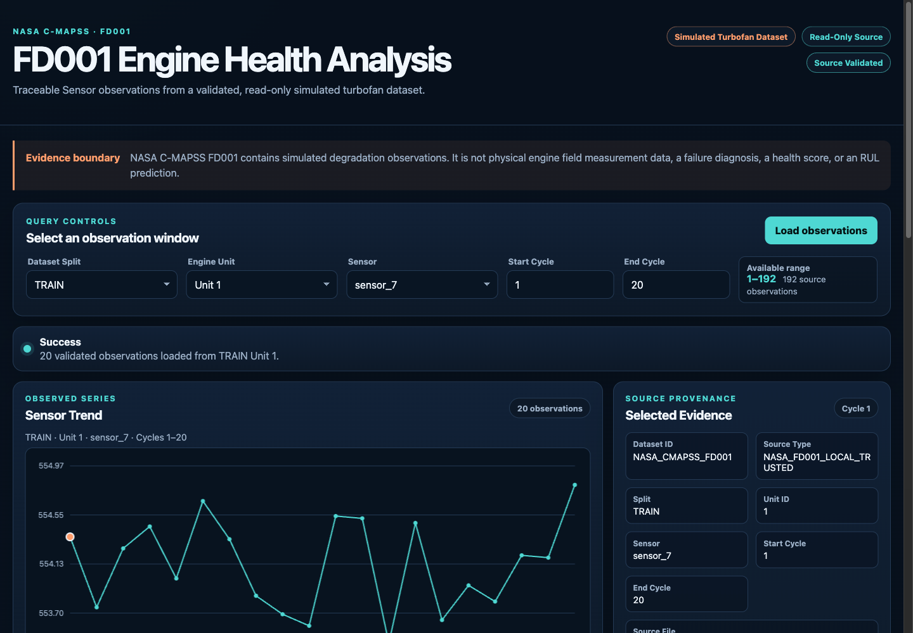
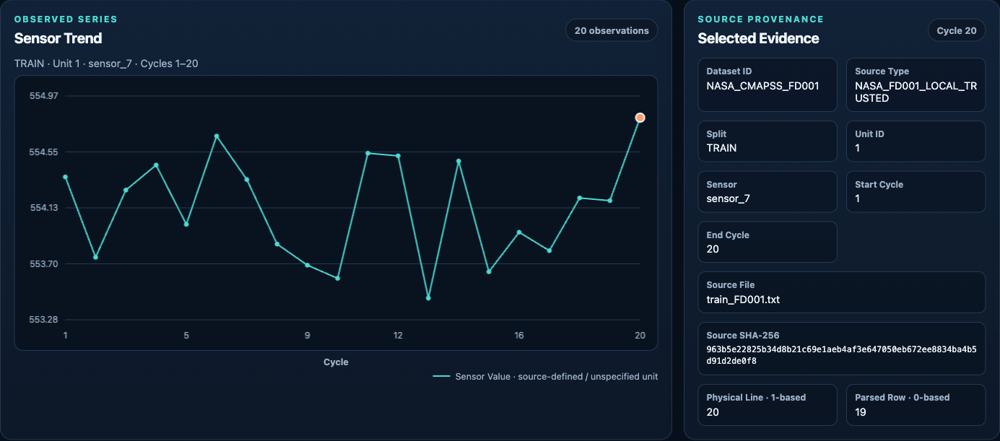
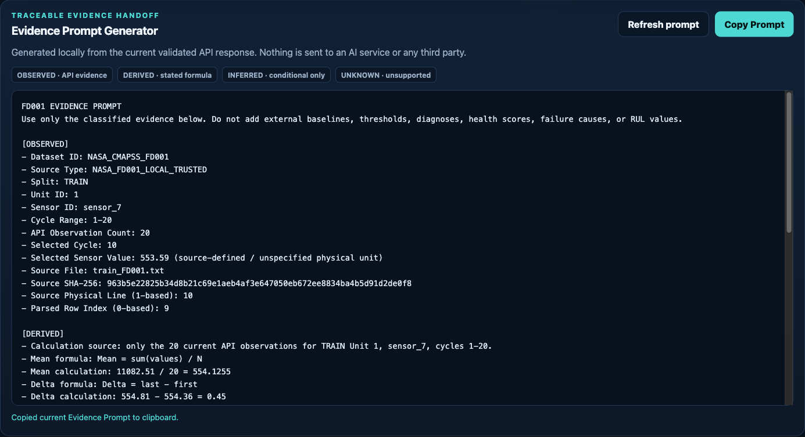
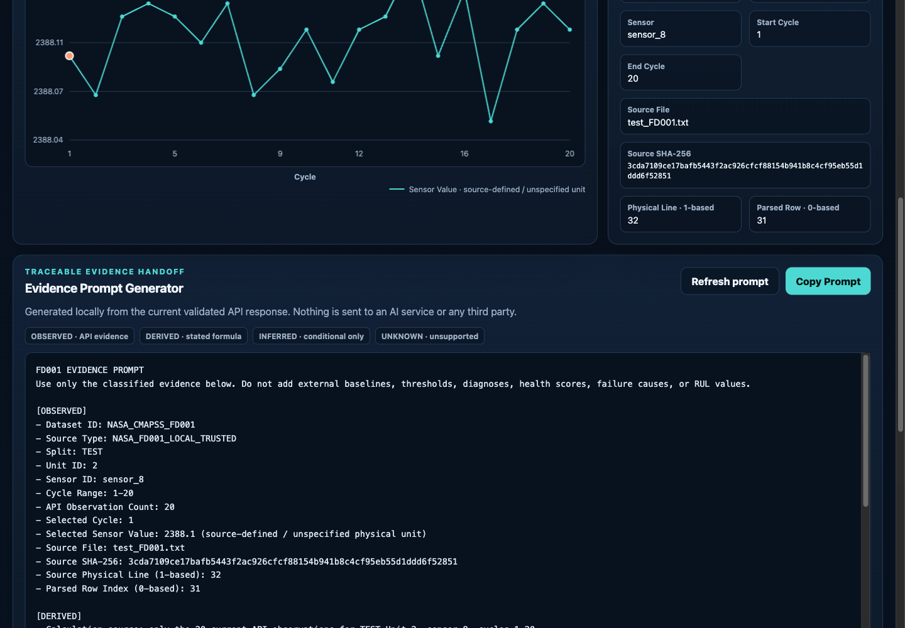

# FD001 M4 Browser Evidence Observations

- Work item: `WO-M4-WEB-EVIDENCE-001`
- Date: 2026-11-23 (Asia/Taipei)
- Browser: Google Chrome 157.0.8103.80 on macOS 27.0.1 arm64
- Production URL: `http://127.0.0.1:8001/`
- Dataset identity: `NASA_CMAPSS_FD001` / `NASA_FD001_LOCAL_TRUSTED`

## Safe visual artifacts

### Initial website and required TRAIN query

TRAIN Unit 1 sensor_7 cycles 1–20 loaded 20 observations. The first row and selected Evidence were Cycle 1, value 554.36, `train_FD001.txt`, physical line 1 and parsed row 0.

### Chart selection and source provenance

The exact Canvas point for Cycle 20 was clicked. The orange selected point, Evidence Cycle 20, physical line 20 and parsed row 19 agreed. The Prompt also changed to Selected Cycle 20.

### Evidence Prompt and Copy result

The visible Prompt for selected Cycle 10 contained OBSERVED source identity and coordinates, DERIVED Mean/Delta formulas over the current 20 API observations, bounded INFERRED statements, UNKNOWN fields and all required simulation disclosures. Copy feedback was visible. Clipboard text and visible text were exactly equal at 2,760 characters.

### Split, Unit and Sensor isolation

After switching to TEST Unit 2 sensor_8, the Chart, Evidence and Prompt used only TEST values and `test_FD001.txt`; physical line 32 / parsed row 31 mapped the selected observation. No TRAIN identity remained.

## Additional interaction observations

- A 2–10 Cycle query produced 9 Table rows and the same range in Chart and Prompt.
- Rapid TRAIN then TEST switching ended exclusively in TEST Unit 1 sensor_8 state; the earlier response did not overwrite it.
- TEST_ONLY 400, 404, 503 and unavailable-backend runs showed Query Validation Error, Observation Not Found, Source Not Validated and Connection Error respectively. Each cleared the Prompt and disabled Copy.
- Forbidden-claim review found no numeric warning/failure threshold, health score, RUL value, confirmed fault diagnosis or claim that Prompt data was sent externally.

Screenshots show only the local application and safe source basenames/hashes/coordinates. They do not show private paths, credentials, secrets, or a bulk raw-source export.
