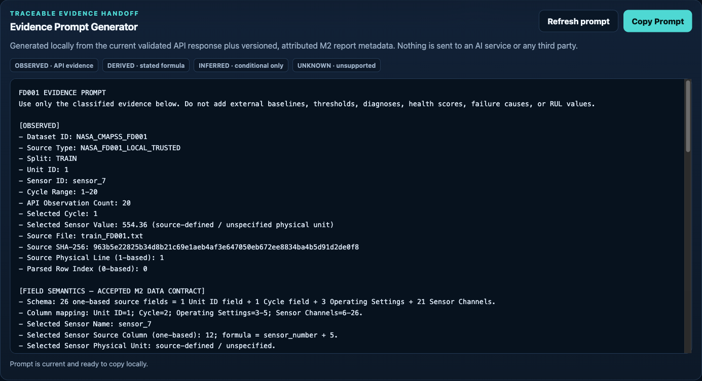
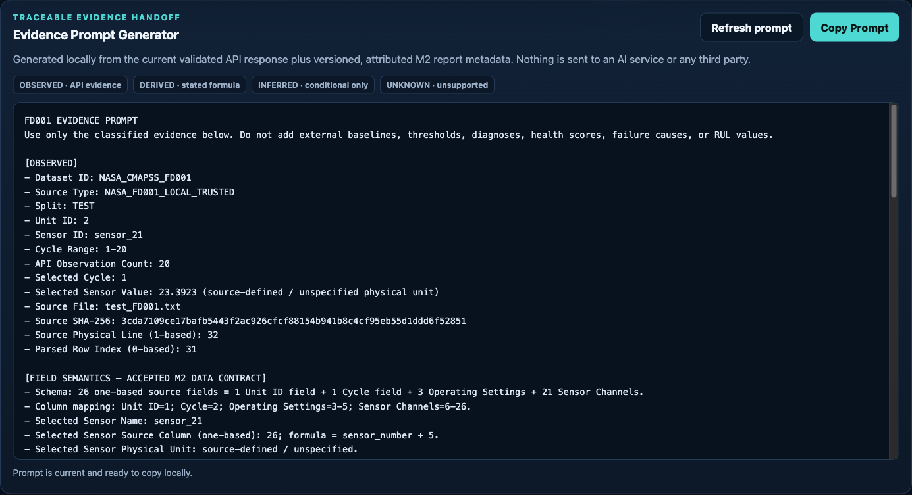

# FD001 Prompt Enhancement Browser Evidence

- Work item: `WO-M4-WEB-PROMPT-ENHANCE-001`
- Browser: Google Chrome 157.0.8103.80
- OS: macOS 27.0.1 arm64
- URL: `http://127.0.0.1:8001/`

## TRAIN Prompt

TRAIN Unit 1 sensor_7 cycles 1–20 loaded 20 real API observations. The Prompt showed source column 12, source-defined/unspecified unit, current-query Mean/Delta, and attributed TRAIN Split-level quality counts of 20,631 observations and 100 Units.

## Chart selection and provenance

The real Canvas point at Cycle 20 was selected. Evidence showed `train_FD001.txt`, the accepted hash, physical line 20 and parsed row 19; Prompt selected Cycle 20.

## TEST isolation and Sensor column

TEST Unit 2 sensor_21 used `test_FD001.txt`, the TEST hash, physical line 32 / parsed row 31, and one-based Sensor source column 26. Its quality context changed to TEST 13,096 observations / 100 Units and did not retain TRAIN Scope.

## Interaction evidence

- Changing the range to cycles 2–10 produced 9 rows and the same DERIVED calculation window.
- Selecting the Table Cycle 5 row updated Evidence to physical line 36 / parsed row 35 and synchronized Prompt selection.
- Copy feedback reported success; explicit browser Clipboard read-back exactly equaled the 5,582-character UI Prompt.
- TEST_ONLY 400, 404, 503 and unavailable-backend states invalidated Prompt and disabled Copy.
- Rapid selection ended in a source-consistent TEST Prompt without stale TRAIN Metadata.
- Prompt review found no numeric fault threshold, fabricated health score, confirmed diagnosis or RUL value.

The evidence contains safe basenames/hashes/coordinates only. No raw source, complete Raw Index, private path or external AI transmission occurred.
